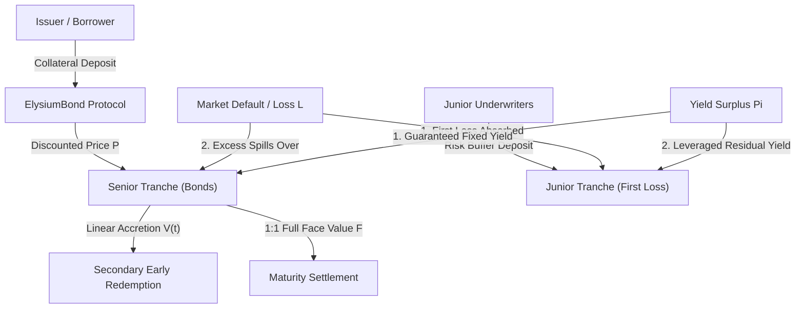

# ElysiumBond

**Decentralized Zero-Coupon Fixed-Yield Bond & Capital-Protection Tranche Protocol on Starknet in Cairo 2.21**

[](https://github.com/ZengLLQ/elysium-bond/actions/workflows/ci.yml)
[](https://opensource.org/licenses/MIT)
[](https://www.cairo-lang.org/)
[](https://starknet.io/)

`ElysiumBond` is a high-performance, non-custodial structured debt and fixed-income protocol implemented in native Cairo 2.21 for Starknet. It enables continuous issuance of zero-coupon discounted bonds protected by a dual-tranche loss-absorption buffer.

---

## Architectural Overview



---

## Mathematical Formulations

### 1. Zero-Coupon Discounted Issuance

For a bond with face value $F$ and annualized discount rate $d_{\text{bps}} \in [0, 5000]$ (basis points, max 50%):

$$\text{Discount} = \left\lfloor \frac{F \cdot d_{\text{bps}}}{10000} \right\rfloor$$

$$P_{\text{issue}} = F - \text{Discount}$$

The guaranteed fixed yield owed to senior bondholders upon maturity is:

$$Y_{\text{senior}} = F - P_{\text{issue}} = \text{Discount}$$

### 2. Linear Value Accretion & Early Redemption

If a bondholder exits before maturity $T_{\text{maturity}}$, early redemption value $V(t)$ linearly accretes from $P_{\text{issue}}$ to $F$:

$$V(t) = \begin{cases}
P_{\text{issue}}, & t \le T_{\text{issue}} \\
P_{\text{issue}} + (F - P_{\text{issue}}) \cdot \frac{t - T_{\text{issue}}}{T_{\text{maturity}} - T_{\text{issue}}}, & T_{\text{issue}} < t < T_{\text{maturity}} \\
F, & t \ge T_{\text{maturity}}
\end{cases}$$

### 3. Waterfall First-Loss Absorption

Protocol losses $L$ (e.g. from collateral shortfalls or bad debt) are absorbed sequentially:

$$\Delta B_{\text{junior}} = \min(L, B_{\text{junior}})$$

$$\text{Senior Haircut} = \max(0, L - B_{\text{junior}})$$

$$B_{\text{junior}}^{(t+1)} = B_{\text{junior}}^{(t)} - \Delta B_{\text{junior}}$$

$$\mathcal{I}_{\text{conservation}} : \Delta B_{\text{junior}} + \text{Senior Haircut} \equiv L$$

Senior bondholders experience zero principal loss as long as $L \le B_{\text{junior}}$.

### 4. Surplus Yield Allocation

When protocol investments yield gross profit $\Pi$:

$$\text{Senior Allocation} = \min(\Pi, Y_{\text{senior}})$$

$$\text{Junior Surplus} = \max(0, \Pi - Y_{\text{senior}})$$

Junior underwriters receive leveraged upside return for underwriting the credit risk buffer.

---

## Protocol State Model

```cairo
pub struct Bond {
    pub bond_id: u64,
    pub issuer: ContractAddress,
    pub holder: ContractAddress,
    pub principal_collateral: u256,
    pub face_value: u256,
    pub discount_rate_bps: u64,
    pub issue_timestamp: u64,
    pub maturity_timestamp: u64,
    pub is_redeemed: bool,
    pub is_defaulted: bool,
}

pub struct TrancheState {
    pub senior_principal: u256,
    pub senior_yield_owed: u256,
    pub junior_buffer: u256,
    pub total_reserves: u256,
    pub min_junior_ratio_bps: u64,
}
```

---

## Verification & Testing

```bash
# Build Sierra and CASM bytecode
scarb build

# Run unit tests
scarb test
```

### Test Suite Summary

```text
running 6 tests
test elysium_bond::tests::test_surplus_yield_distribution ... ok (gas usage est.: 300)
test elysium_bond::tests::test_early_redemption_linear_accretion ... ok (gas usage est.: 129310)
test elysium_bond::tests::test_loss_absorption_conservation_invariant ... ok (gas usage est.: 66930)
test elysium_bond::tests::test_junior_deficit_and_senior_haircut ... ok (gas usage est.: 300)
test elysium_bond::tests::test_junior_first_loss_absorption ... ok (gas usage est.: 300)
test elysium_bond::tests::test_discounted_issuance_pricing ... ok (gas usage est.: 51800)
test result: ok. 6 passed; 0 failed; 0 ignored; 0 filtered out;
```

---

## License

This project is licensed under the [MIT License](LICENSE).
